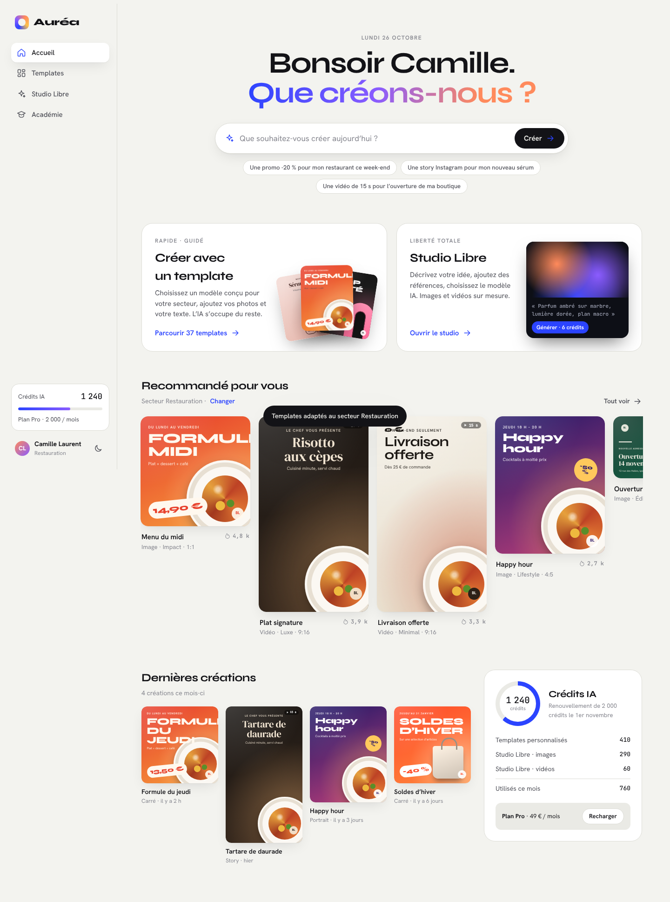
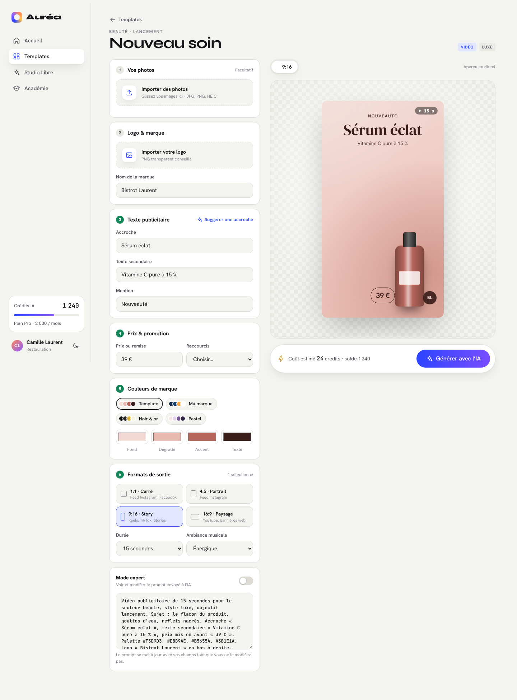
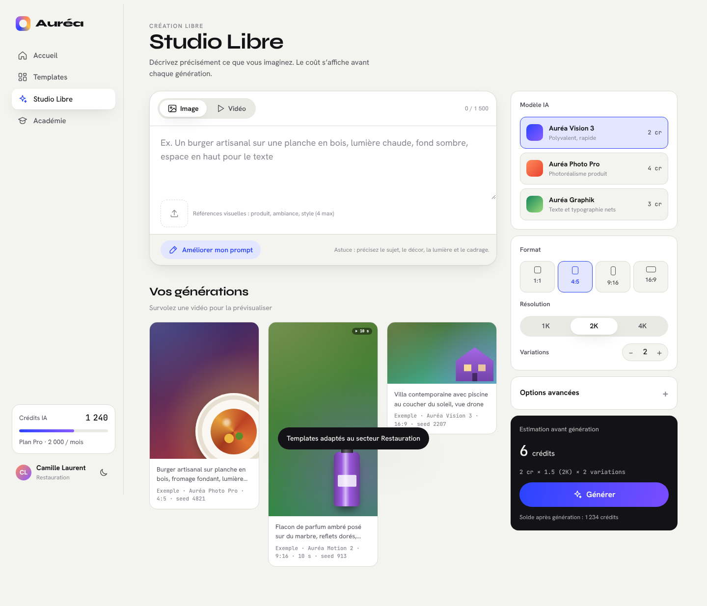

# Auréa

Prototype interactif d’une plateforme SaaS premium de création publicitaire par intelligence artificielle, destinée aux entreprises, indépendants, créateurs de contenu et agences de communication.

## Ouvrir le prototype

Ouvrez `index.html` dans un navigateur. Aucun build ni dépendance : un seul fichier HTML, CSS et JavaScript.

## Écrans

| Écran | Contenu |
| --- | --- |
| Inscription | Choix du secteur d’activité (9 secteurs), qui personnalise toute la plateforme |
| Tableau de bord | Message d’accueil, barre « Que souhaitez-vous créer aujourd’hui ? », accès Template / Studio Libre, templates recommandés, dernières créations, solde de crédits IA |
| Bibliothèque de templates | 37 templates images et vidéos, filtres type / style / objectif / format, tri par popularité, recherche |
| Personnalisation | Import de photos et de logo, texte publicitaire, prix et promotions, couleurs de marque, formats de sortie, aperçu en direct, coût en crédits, mode expert (prompt caché par défaut) |
| Studio Libre | Image ou vidéo, prompt, références visuelles, choix du modèle IA, format, résolution, durée, variations, options avancées, « Améliorer mon prompt », estimation du coût avant génération |
| Académie | Tutoriels vidéo, guides débutants, techniques avancées, bibliothèque de prompts, exemples professionnels |

## Limites du prototype

- Aucune IA n’est branchée : les visuels sont dessinés en CSS et les générations sont simulées.
- Les données (utilisateur, crédits, créations, exemples) sont fictives.
- Le secteur, le thème et les crédits sont mémorisés dans le navigateur (`localStorage`).

## Captures

